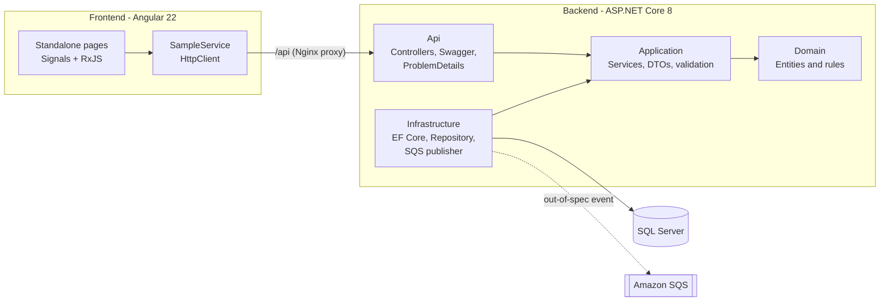

# ⚗️ LabTrack: Laboratory Sample Management

🇧🇷 [Leia em português](README.pt-BR.md)


A full stack **laboratory quality control** system for the chemical industry. It records samples
from production batches and their analysis results (pH, viscosity, concentration, density…), then
compares each value against its **specification limits**. If any result falls outside the range,
the sample is **automatically rejected** and an **event is published** (AWS SQS) to notify the team.

> A project that combines my background in **Chemical Engineering** with **software development**.

## ✨ Features

- **Quality dashboard** with approved, rejected and pending samples, approval rate and latest deviations
- **Sample management** (code, product, batch, collection date, notes), including edit and delete
- **Analysis results** with optional minimum and maximum limits
- **Business rule in the domain:** no results = *Pending*; any out-of-spec result = *Rejected*; all within spec = *Approved*
- **Reactive search** by code, product or batch, with a status filter (RxJS `debounceTime` + `switchMap`)
- **Integration event** `OutOfSpecDetected` published to **Amazon SQS**, ready to be consumed by an AWS Lambda, for example
- Standardized errors using **ProblemDetails (RFC 7807)**: 400, 404, 409 and 422

## 🏗️ Architecture



Layered architecture inspired by *Clean Architecture*. The **Domain** has no dependencies,
the **Application** layer defines the interfaces (`ISampleRepository`, `IEventPublisher`) and the **Infrastructure** layer implements them.

```
labtrack-fullstack/
├── backend/
│   ├── src/
│   │   ├── LabTrack.Domain/          # Sample and AnalysisResult entities, status rule
│   │   ├── LabTrack.Application/     # SampleService, DTOs, exceptions, interfaces
│   │   ├── LabTrack.Infrastructure/  # DbContext, migrations, seed, repository, SQS
│   │   └── LabTrack.Api/             # Controllers, Program.cs, error handling
│   └── tests/
│       ├── LabTrack.UnitTests/        # xUnit: domain + service (in-memory SQLite)
│       └── LabTrack.IntegrationTests/ # xUnit + WebApplicationFactory (full API)
├── frontend/                          # Angular 22 (standalone, signals, RxJS, Vitest)
├── docker-compose.yml                 # SQL Server + API + Web (Nginx)
└── .github/workflows/ci.yml           # Build, tests and Docker images
```

## 🔌 Endpoints

| Method | Route | Description |
| --- | --- | --- |
| `GET` | `/api/samples?search=&status=` | List samples (search and filter by `Pending`, `Approved` or `Rejected`) |
| `GET` | `/api/samples/{id}` | Get a sample with its results |
| `POST` | `/api/samples` | Create a sample (`409` if the code already exists) |
| `PUT` | `/api/samples/{id}` | Update a sample |
| `DELETE` | `/api/samples/{id}` | Delete a sample and its results |
| `POST` | `/api/samples/{id}/results` | Add an analysis result (`422` if minimum > maximum) |
| `GET` | `/api/dashboard` | Quality indicators |
| `GET` | `/health` | Health check (includes the database) |

Interactive documentation is available in **Swagger** at `/swagger`.

## 🚀 Getting started

### Option 1: Docker Compose (recommended)

```bash
docker compose up --build
```

| Service | URL |
| --- | --- |
| Front-end | http://localhost:4200 |
| API + Swagger | http://localhost:5080/swagger |
| SQL Server | `localhost,1433` (user `sa`) |

Migrations are applied automatically and the database starts with sample data.

### Option 2: Run locally

Prerequisites: [.NET 8 SDK](https://dotnet.microsoft.com/download), [Node.js 24](https://nodejs.org) and SQL Server (local or via `docker compose up db`).

```bash
# Back-end (http://localhost:5080/swagger)
cd backend
dotnet run --project src/LabTrack.Api

# Front-end (http://localhost:4200), in another terminal
cd frontend
npm install
npm start
```

During development, Angular forwards `/api` requests to the API through `proxy.conf.json`.

### Publishing events to AWS SQS

By default, events are only written to the log, so no AWS account is needed. To publish to a real queue:

```bash
Messaging__Provider=Sqs
Messaging__SqsQueueUrl=https://sqs.us-east-1.amazonaws.com/123456789012/labtrack-out-of-spec
AWS_REGION=us-east-1   # credentials come from the default AWS chain (env, profile or IAM role)
```

## ✅ Tests

```bash
cd backend && dotnet test          # 26 tests: unit + integration
cd frontend && npx ng test --watch=false
```

- **Unit:** specification and status rules, plus the service (duplicate code, event publishing, dashboard)
- **Integration:** the full API running in memory with `WebApplicationFactory` and SQLite, covering the end-to-end flow, 400, 404, 409 and 422 responses, and the health check

## 🛠️ Tech stack

**Back-end:** C# · ASP.NET Core 8 Web API · Entity Framework Core 8 · SQL Server · Swagger · AWS SDK (SQS) · xUnit
**Front-end:** Angular 22 · TypeScript · RxJS · Signals · Reactive Forms · Vitest
**DevOps:** Docker (multi-stage) · Docker Compose · Nginx · GitHub Actions

## 👩‍💻 Author

**Marcielle Santos**: [LinkedIn](https://www.linkedin.com/in/marciellesantos-dev) · marcielle.san@gmail.com

[MIT](LICENSE) License.
