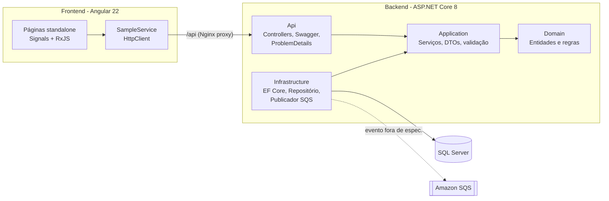

# ⚗️ LabTrack: Gestão de Amostras de Laboratório


Sistema full stack de **controle de qualidade laboratorial** para a indústria química. Ele registra
amostras de lotes de produção e seus resultados de análise (pH, viscosidade, concentração, densidade…)
e compara cada valor com os **limites de especificação**. Se algum resultado ficar fora da faixa,
a amostra é **reprovada automaticamente** e um **evento é publicado** (AWS SQS) para notificar a equipe.

> Projeto que une minha formação em **Engenharia Química** com **desenvolvimento de software**.

## ✨ Funcionalidades

- **Painel de qualidade** com amostras aprovadas, reprovadas e pendentes, taxa de aprovação e últimos desvios
- **Cadastro de amostras** (código, produto, lote, data de coleta, observações), com edição e exclusão
- **Registro de resultados** com limites mínimo e máximo opcionais
- **Regra de negócio no domínio:** sem resultados = *Pendente*; algum fora da especificação = *Reprovada*; todos dentro = *Aprovada*
- **Busca reativa** por código, produto ou lote, com filtro por status (RxJS `debounceTime` + `switchMap`)
- **Evento de integração** `OutOfSpecDetected` publicado no **Amazon SQS**, que pode ser consumido, por exemplo, por uma AWS Lambda
- Erros padronizados em **ProblemDetails (RFC 7807)**: 400, 404, 409 e 422

## 🏗️ Arquitetura



Arquitetura em camadas (inspirada em *Clean Architecture*): o **Domain** não depende de nada,
a **Application** define as interfaces (`ISampleRepository`, `IEventPublisher`) e a **Infrastructure** as implementa.

```
labtrack-fullstack/
├── backend/
│   ├── src/
│   │   ├── LabTrack.Domain/          # Entidades Sample, AnalysisResult e regra de status
│   │   ├── LabTrack.Application/     # SampleService, DTOs, exceções, interfaces
│   │   ├── LabTrack.Infrastructure/  # DbContext, migrations, seed, repositório, SQS
│   │   └── LabTrack.Api/             # Controllers, Program.cs, tratamento de erros
│   └── tests/
│       ├── LabTrack.UnitTests/        # xUnit: domínio + serviço (SQLite em memória)
│       └── LabTrack.IntegrationTests/ # xUnit + WebApplicationFactory (API completa)
├── frontend/                          # Angular 22 (standalone, signals, RxJS, Vitest)
├── docker-compose.yml                 # SQL Server + API + Web (Nginx)
└── .github/workflows/ci.yml           # Build, testes e imagens Docker
```

## 🔌 Endpoints

| Método | Rota | Descrição |
| --- | --- | --- |
| `GET` | `/api/samples?search=&status=` | Lista amostras (busca e filtro por `Pending`, `Approved` ou `Rejected`) |
| `GET` | `/api/samples/{id}` | Detalha a amostra com resultados |
| `POST` | `/api/samples` | Cria amostra (`409` se o código já existir) |
| `PUT` | `/api/samples/{id}` | Atualiza amostra |
| `DELETE` | `/api/samples/{id}` | Remove amostra e resultados |
| `POST` | `/api/samples/{id}/results` | Registra resultado (`422` se mínimo > máximo) |
| `GET` | `/api/dashboard` | Indicadores de qualidade |
| `GET` | `/health` | Health check (inclui banco de dados) |

A documentação interativa fica disponível no **Swagger** em `/swagger`.

## 🚀 Como executar

### Opção 1: Docker Compose (recomendado)

```bash
docker compose up --build
```

| Serviço | URL |
| --- | --- |
| Front-end | http://localhost:4200 |
| API + Swagger | http://localhost:5080/swagger |
| SQL Server | `localhost,1433` (usuário `sa`) |

As migrations são aplicadas automaticamente e o banco já sobe com amostras de exemplo.

### Opção 2: Localmente

Pré-requisitos: [.NET 8 SDK](https://dotnet.microsoft.com/download), [Node.js 24](https://nodejs.org) e SQL Server (local ou via `docker compose up db`).

```bash
# Back-end (http://localhost:5080/swagger)
cd backend
dotnet run --project src/LabTrack.Api

# Front-end (http://localhost:4200), em outro terminal
cd frontend
npm install
npm start
```

Em desenvolvimento, o Angular redireciona `/api` para a API via `proxy.conf.json`.

### Publicação de eventos no AWS SQS

Por padrão, os eventos são apenas registrados no log, então você não precisa de conta AWS. Para publicar numa fila real:

```bash
Messaging__Provider=Sqs
Messaging__SqsQueueUrl=https://sqs.us-east-1.amazonaws.com/123456789012/labtrack-out-of-spec
AWS_REGION=us-east-1   # credenciais pela cadeia padrão da AWS (env, perfil ou IAM role)
```

## ✅ Testes

```bash
cd backend && dotnet test          # 26 testes: unitários + integração
cd frontend && npx ng test --watch=false
```

- **Unitários:** regras de especificação e status, além do serviço (código duplicado, evento publicado, dashboard)
- **Integração:** a API completa em memória com `WebApplicationFactory` e SQLite, cobrindo fluxo de ponta a ponta, validação 400, 404, 409, 422 e health check

## 🛠️ Tecnologias

**Back-end:** C# · ASP.NET Core 8 Web API · Entity Framework Core 8 · SQL Server · Swagger · AWS SDK (SQS) · xUnit
**Front-end:** Angular 22 · TypeScript · RxJS · Signals · Reactive Forms · Vitest
**DevOps:** Docker (multi-stage) · Docker Compose · Nginx · GitHub Actions

## 👩‍💻 Autora

**Marcielle Santos**: [LinkedIn](https://www.linkedin.com/in/marciellesantos-dev) · marcielle.san@gmail.com

Licença [MIT](LICENSE).
